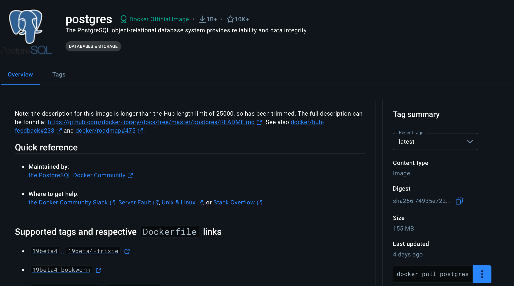
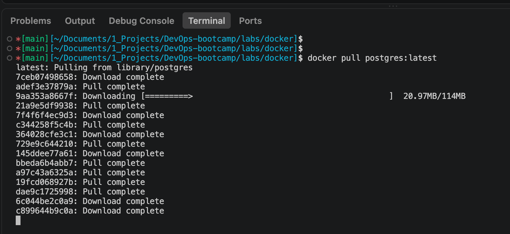

## How to run different versions of a Docker image

### Running first version `latest`
- From drop down select the most recent tag `latest`

- Use the command `docker pull postgres:latest` to select the version

